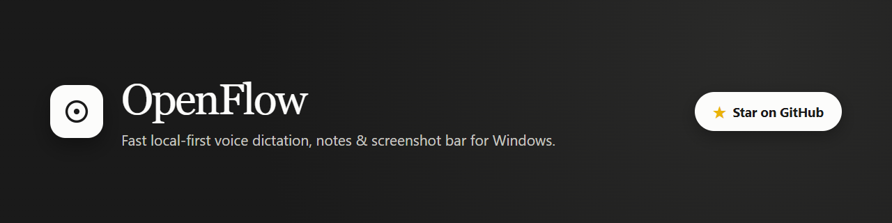
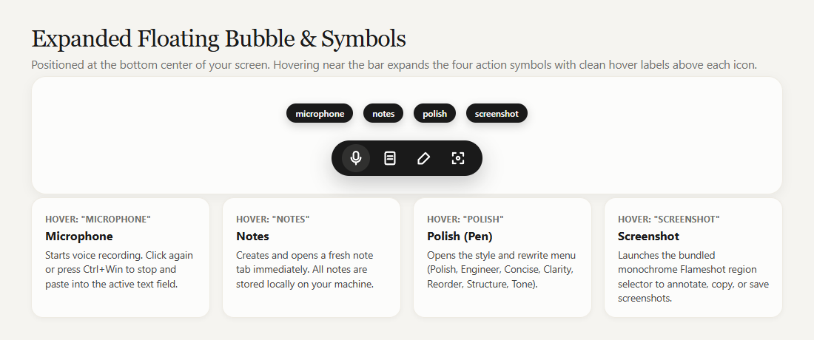
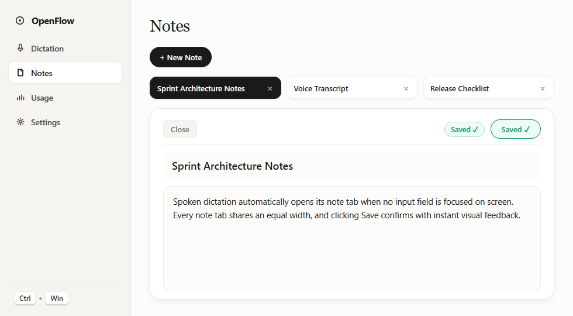
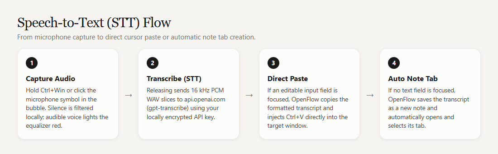
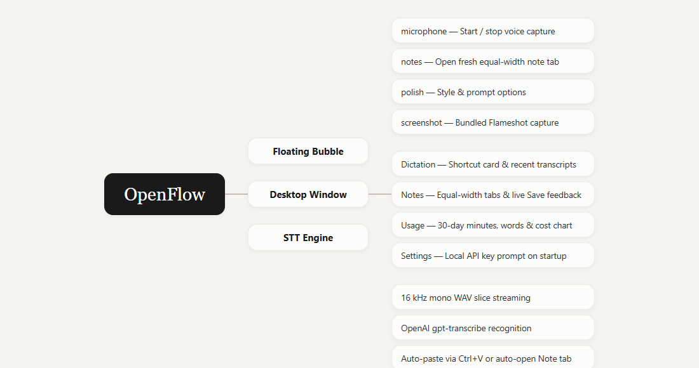
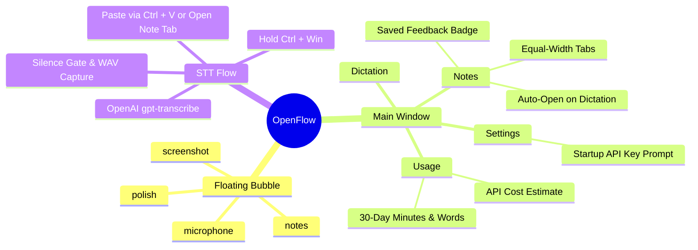

<p align="center">
  <a href="https://github.com/LuiInventions/OpenFlow">
    
  </a>
</p>

<p align="center">
  <a href="https://github.com/LuiInventions/OpenFlow/stargazers"></a>
  <a href="https://github.com/LuiInventions/OpenFlow/releases/latest"></a>
  <a href="LICENSE"></a>
</p>

**OpenFlow** is a fast, local-first voice dictation, quick notes, and screenshot dock for Windows. Speech recognition runs directly through your own OpenAI API key (`gpt-transcribe`), while all notes, dictation history, usage metrics, and settings stay 100% locally on your PC.

The compact floating bubble rests at the bottom of your screen. Hold `Ctrl` + `Win`, speak naturally, and release: OpenFlow transcribes your voice and pastes the text directly into the focused input field—or automatically saves and opens it as a new note tab when no text field is active.

---

## Floating Bubble & Symbols

<p align="center">
  
</p>

When idle, the floating bar collapses into a subtle dark pill at the bottom of the screen. Moving your cursor near the pill smoothly expands it to reveal four action icons. Hovering over any icon cleanly displays its label (`microphone`, `notes`, `polish`, `screenshot`) right above the symbol.

| Symbol | Hover Label | What It Does |
| :--- | :--- | :--- |
| **Microphone** | `microphone` | Starts voice recording immediately. Click again or press `Ctrl` + `Win` once to finish recording and transcribe. |
| **Note** | `notes` | Creates a new blank note, opens the Notes window, and selects the new note tab ready for editing. |
| **Pen / Sparkle** | `polish` | Displays the style modes (`Correction`, `Engineer`, `Style`) in a clean floating popover menu. |
| **Screenshot** | `screenshot` | Launches the bundled monochrome Flameshot region selector to capture, annotate, copy, or save a screenshot. |

During recording, the bubble transforms into a live audio waveform meter (glowing coral-red when speech is detected, or omitting silent recordings automatically). Once released, a crisp spinner indicates transcription is in progress until the text is pasted.

---

## Application UI & Workspace Tabs

<p align="center">
  
</p>

OpenFlow features a warm, distraction-free two-column layout (`820 × 540`) inspired by modern tactile workspaces—combining a vertical navigation sidebar on the left with a spacious content area on the right:

- **Dictation**: Displays the global hold-to-talk shortcut (`Ctrl` + `Win`), the latest transcription with a one-click **Copy** button, and your recent dictation history.
- **Notes**: Displays every note in a strict **equal-width tab bar** along the top of the workspace (`grid-auto-columns: minmax(0, 1fr)`), ensuring open or active tabs never stretch unevenly. Selecting any tab opens the modern, rounded note editor with **Back** and **Save** actions. Clicking **Save** (or pressing `Ctrl` + `S`) persists your edits and triggers an immediate green **`Saved ✓`** confirmation badge.
- **Usage**: Summarizes your last 30 days of activity—total recorded minutes, estimated OpenAI API cost, and total spoken words—paired with an activity bar chart computed locally from your saved dictations.
- **Settings**: Manages your OpenAI API key (`sk-...`). If no API key is configured yet, OpenFlow automatically opens the Settings view and prompts you for your API key whenever the application starts or is brought to the foreground.

Left-clicking the system tray icon brings the OpenFlow window to the front and refreshes notes, usage, and dictation history. Right-clicking the tray icon opens the quick tray menu.

---

## Speech-to-Text (STT) Flow

<p align="center">
  
</p>

1. **Hold & Speak (`Ctrl` + `Win` or `microphone`)**: OpenFlow captures 16-bit PCM audio at 24 kHz and monitors RMS energy + speech-band zero-crossing rates. Pure silence is discarded automatically so no API credits are wasted.
2. **Transcribe (`gpt-transcribe`)**: Valid speech audio is packaged as a WAV buffer and sent over HTTPS to `api.openai.com/v1/audio/transcriptions` using the `gpt-transcribe` model with automatic language detection.
3. **Direct Paste (`Ctrl` + `V`)**: When an editable input field was focused before recording started, OpenFlow writes the transcript to the clipboard and dispatches `Ctrl` + `V` into the target window.
4. **Auto-Open Note Tab (Fallback)**: When no text input field is focused—or if pasting is unavailable—OpenFlow automatically saves the dictated text as a new note and **immediately opens and selects that note tab** in the UI.

> **Cost Estimation**: The **Usage** tab estimates transcription cost using the public `gpt-transcribe` list rate of `$0.0045 USD` per minute of audio.

---

## Architecture Mindmap

<p align="center">
  
</p>



---

## Installation & Building from Source

### Download Installer (Recommended)

Download the latest Windows installer from the [**Releases**](https://github.com/LuiInventions/OpenFlow/releases) page:

- **`OpenFlow-Setup-0.1.0.exe`** — Standard Windows NSIS installer with customizable install directory, Start Menu entry, and Desktop shortcut.
- **`OpenFlow-Portable-0.1.0.exe`** — Standalone portable executable.

Requirements: Windows 10 or Windows 11 (64-bit) and an OpenAI API key.

### Build from Source

Requires **Node.js 22+**:

```bash
npm ci
npm test
npm run dist
```

This builds the Windows NSIS installer (`release/OpenFlow-Setup-0.1.0.exe`) and portable executable (`release/OpenFlow-Portable-0.1.0.exe`).

---

## Flameshot Integration & License

OpenFlow bundles the official Windows build of [Flameshot 14.0.0](https://github.com/flameshot-org/flameshot/releases/tag/v14.0.0) for its screenshot action. Flameshot is licensed under the **GNU General Public License v3.0 (GPL-3.0-only)**, and OpenFlow is distributed under the same **GPL-3.0-only** license. See [LICENSE](LICENSE) for the full license text.
